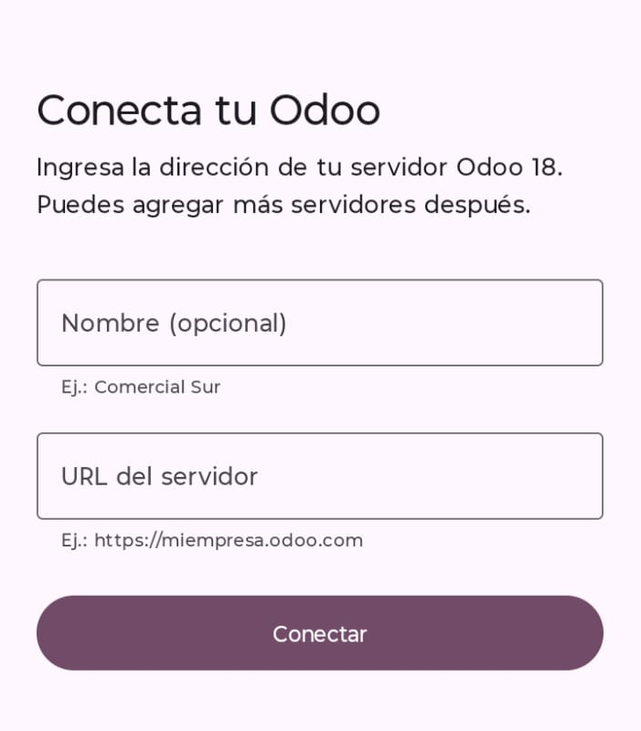
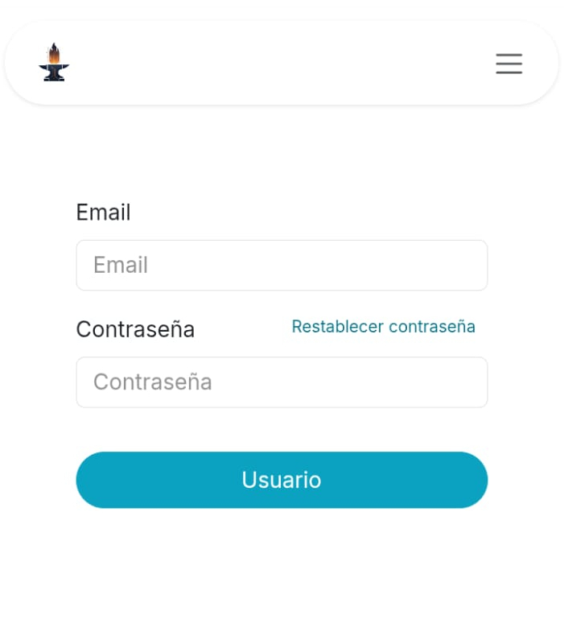
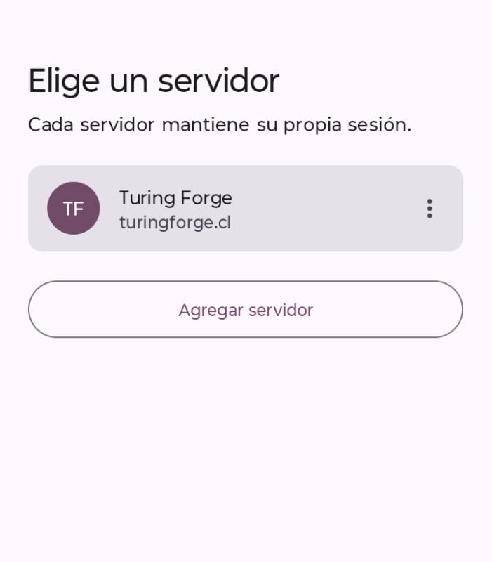

# Manual de usuario — Odoo en tu celular

La app abre tu Odoo de siempre en una pantalla pensada para Android. Puedes usar la cámara para adjuntar fotos, tus reportes PDF se guardan directo en Descargas y, si trabajas con varias empresas, cada una tiene su propia sesión.

**Antes de empezar necesitas**

- Un celular con Android 8 o superior.
- La dirección de tu servidor Odoo, por ejemplo `miempresa.odoo.com`. Si no la conoces, pídela a tu área de sistemas.
- Tu usuario y contraseña de Odoo.

---

## 1. Conectar tu servidor

La primera vez que abres la app aparece la pantalla **Conecta tu Odoo**.

1. **Nombre (opcional).** Un nombre para reconocerlo, como «Comercial Sur». Si lo dejas vacío se usa la dirección.
2. **URL del servidor.** Escribe la dirección. No hace falta poner `https://` ni nada antes del dominio: la app lo completa.
3. **Conectar.** La app comprueba que el servidor responde y que es Odoo 18, y abre la pantalla de inicio de sesión.

> **¿Apareció un aviso?**
> 
> - **«No pudimos verificar el servidor»**: revisa que la dirección esté bien escrita y que tengas internet. Si estás seguro de que es correcta, toca **Continuar**.
> - **«Versión distinta»**: tu servidor no es Odoo 18. Puedes continuar, aunque algunas funciones podrían comportarse distinto.

## 2. Iniciar sesión

La app abre directamente la página de acceso, aunque tu empresa tenga un sitio web público. Ingresa tu correo y contraseña de Odoo.

La sesión queda guardada: la próxima vez entrarás directo a Odoo, incluso después de reiniciar el celular. Para cerrarla, usa el menú de tu usuario en Odoo → **Cerrar sesión**.

## 3. Uso diario

Odoo funciona igual que en el computador, con su diseño para celular. Puedes girar la pantalla sin perder lo que estabas escribiendo.

- **Botón Atrás:** te devuelve a la pantalla anterior de Odoo (por ejemplo, del formulario a la lista).
- **Salir:** cuando ya no hay pantallas anteriores, la app pregunta si quieres salir. Ese mismo aviso muestra a qué servidor estás conectado y ofrece **Cambiar servidor**.

## 4. Adjuntar fotos y archivos

En cualquier lugar de Odoo donde puedas adjuntar algo (el clip del chatter, la foto de un producto o de un contacto) puedes elegir:

- **Cámara:** toma la foto en el momento.
- **Galería o Archivos:** elige uno o varios archivos ya guardados.

La primera vez la app pide permiso para usar la cámara. Si lo rechazas, igual puedes elegir archivos de la galería.

## 5. Descargar reportes y documentos

Cuando imprimes una factura, una orden de venta o cualquier reporte, el PDF se guarda en la carpeta **Descargas** del celular. Abajo aparece un aviso con el botón **Abrir** para verlo de inmediato.

Los adjuntos descargados se muestran también en la barra de notificaciones. En Android 9 o anterior, la primera descarga pide permiso de almacenamiento.

## 6. Escanear códigos de barras

En Inventario y otras apps de Odoo con escáner, toca el ícono de código de barras. La cámara se abre dentro de Odoo; si es la primera vez, acepta el permiso.

## 7. Trabajar con varias empresas

Si tu grupo tiene un servidor Odoo por empresa, puedes registrarlos todos. Cada uno guarda su propia sesión: entrar a una empresa no te saca de la otra.

### Agregar un servidor

Abre el selector de servidores (ver abajo) → **Agregar servidor** → completa nombre y URL → **Conectar**.

### Cambiar de servidor

Tienes tres caminos:

- **A. Al abrir la app.** Con dos o más servidores, la app te pregunta a cuál entrar.
- **B. Manteniendo presionado el ícono de la app.** Aparecen tus empresas más recientes y la opción **Servidores**. Puedes arrastrar una empresa a la pantalla de inicio para tener su propio acceso.
- **C. Desde dentro de la app.** Presiona Atrás hasta el aviso de salida → **Cambiar servidor**.

### Editar o eliminar

En el selector, toca los tres puntos (⋮) junto a un servidor → **Editar** o **Eliminar**. Eliminar cierra la sesión de ese servidor y borra sus datos del celular; los datos en Odoo no se tocan.

### Abrir siempre la última empresa

Si casi siempre usas la misma, desactiva **Preguntar al abrir la app** al final del selector. La app abrirá directamente la última empresa que usaste.

## 8. Si algo no funciona

| Problema                                | Qué hacer                                                                                                              |
| --------------------------------------- | ---------------------------------------------------------------------------------------------------------------------- |
| Aparece «No se pudo cargar Odoo»        | Revisa tu conexión y toca **Reintentar**. Si la dirección del servidor cambió, toca **Cambiar servidor**.              |
| Me pide la contraseña de nuevo          | La sesión de Odoo venció o un administrador la cerró. Vuelve a ingresar; la app la recordará otra vez.                 |
| «Iniciar sesión con Google» no funciona | Google no permite ese acceso dentro de apps como esta. Pide a tu administrador una contraseña de Odoo para tu usuario. |
| El PDF se descargó pero no se abre      | Instala un lector de PDF (por ejemplo Google Drive o Adobe Acrobat). El archivo está en **Descargas**.                 |
| No puedo adjuntar con la cámara         | Activa el permiso en **Ajustes → Apps → Odoo → Permisos → Cámara**.                                                    |
| Odoo se ve mal o no carga partes        | Actualiza **Android System WebView** y **Chrome** desde Play Store.                                                    |

---

**Tus datos.** La app solo guarda en el celular la lista de servidores y tu sesión de cada uno. No envía información a terceros: todo lo que haces queda en tu servidor Odoo, igual que desde el navegador.
